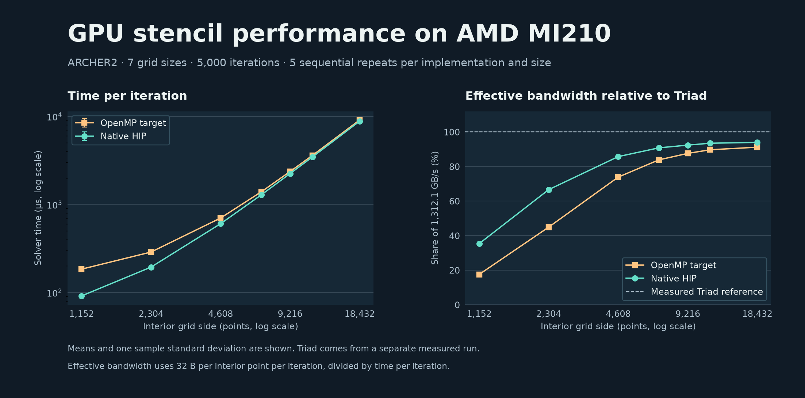
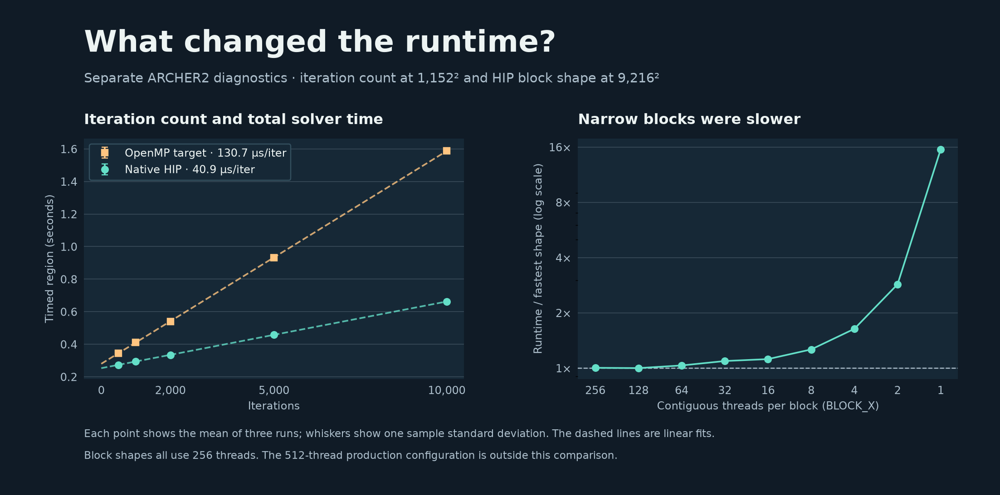

# Evaluation of OpenMP and HIP for GPU Acceleration of a 2D CFD Stencil

MSc High Performance Computing dissertation case study, University of
Edinburgh, 2025–26. I ported the supplied irrotational-flow solver to native
HIP and evaluated it against the supplied OpenMP target implementation on
an AMD Instinct MI210. Both implementations retain a Jacobi update followed
by a copy-back pass. This made it possible to study the programming models
with the same numerical workload.



## What the recorded experiments show

| Interior grid | OpenMP target, mean µs/iteration | Native HIP, mean µs/iteration | OpenMP / HIP |
| --- | ---: | ---: | ---: |
| 1,152 × 1,152 | 184.0 | 91.4 | 2.01× |
| 9,216 × 9,216 | 2,364.3 | 2,241.8 | 1.05× |
| 18,432 × 18,432 | 9,085.2 | 8,816.8 | 1.03× |

The main comparison covers seven sizes and five sequential 5,000-iteration
runs per implementation and size. The native HIP advantage narrowed as the
grid grew. At the largest size, the effective bandwidth model gives about
94.0% of the measured Triad reference for HIP and 91.2% for OpenMP. That
calculation uses 32 bytes per interior point per iteration and the measured
solver time. It is distinct from the HBM counter measurements.



Two separate diagnostics help explain the performance gap. At 1,152 × 1,152,
the iteration sweep fitted 130.7 µs per iteration for OpenMP and 40.9 µs for
HIP. The profiled stencil and copy-back kernels took about 44.9 µs and 40.7 µs
per iteration, respectively, in separate profiling passes. This points to a
difference outside the profiled main kernels. The measurements do not isolate
a specific runtime operation. In a separate tuning experiment, the narrowest
HIP block was about 15.6× slower than the fastest shape with the same total
thread count.

## Numerical checks

The archived HIP, OpenMP target and serial checks agree at the printed
precision for the interior checksum and normalized update error in four
configurations. A fresh local host check also compared complete serial and
OpenMP host-fallback fields against a separate reference on four small cases.
The local check used offload disabled. The archived GPU checks establish
agreement of the recorded scalar diagnostics.

## Recreate the charts

From this branch, use Python 3.11 or later with the pinned plotting dependency.

```sh
python3 -m venv .venv
. .venv/bin/activate
python -m pip install -r requirements.txt
python scripts/plot_results.py
```

The script validates the sample counts and regenerates both PNGs from the
included [timings](data/mi210-timings.csv), [iteration sweep](data/mi210-iteration-sweep.csv)
and [block-shape sweep](data/mi210-block-shapes.csv). The [methods and evidence notes](docs/evidence.md)
document the timing boundaries, compiler settings, validation and source
attribution. The [source review](docs/source-review.md) explains the solver and
the scope of the fresh local check.
